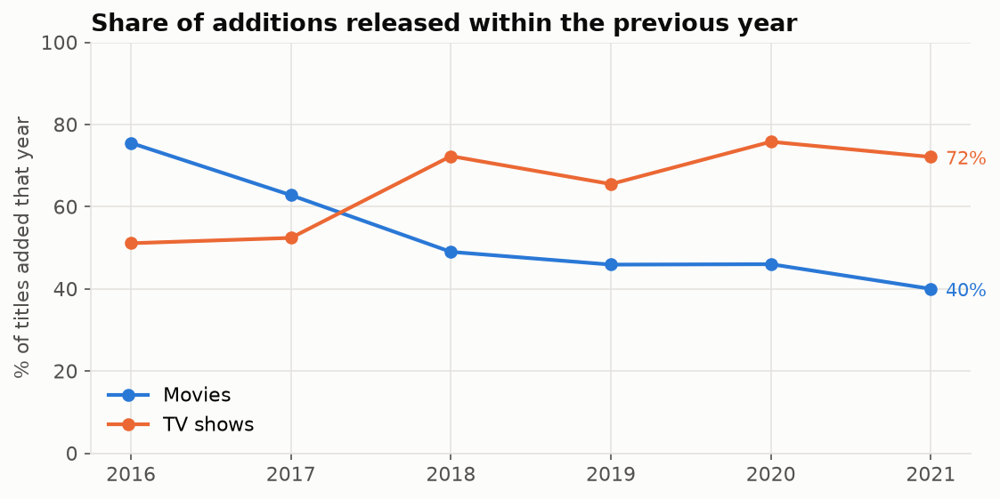
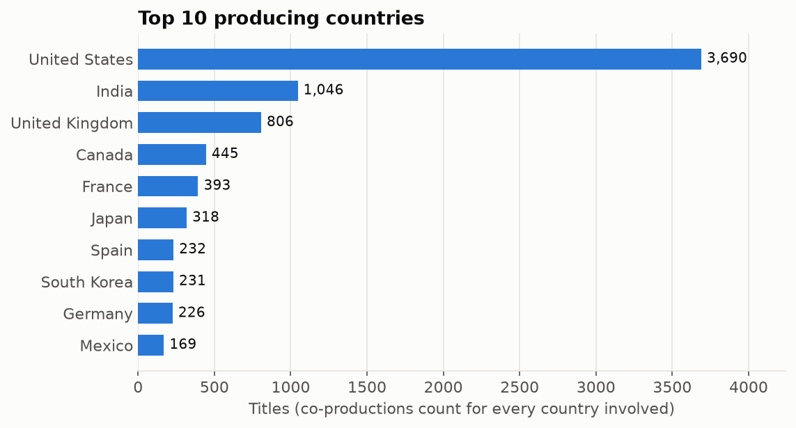
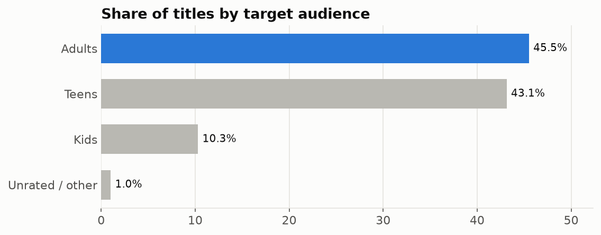
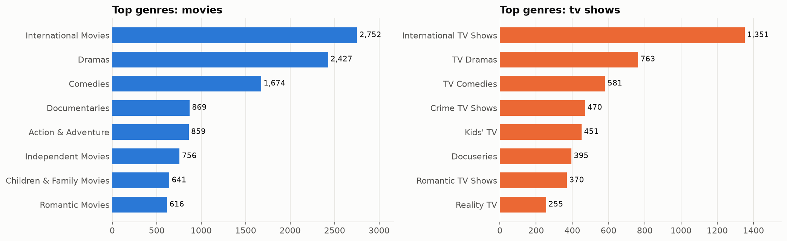
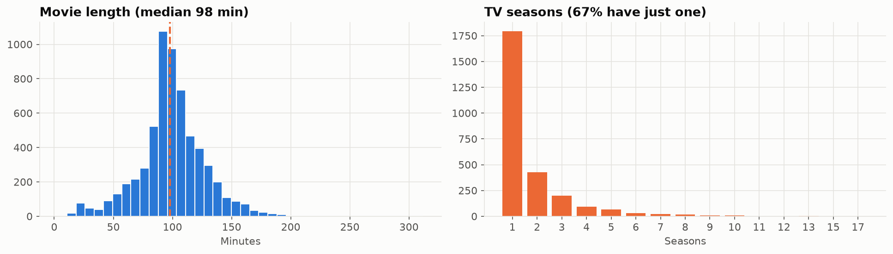

# Netflix catalogue analysis

8,807 Netflix titles (to September 2021): how the catalogue grew, where content comes from, which genres and audiences dominate, and whether Netflix adds new releases or back catalogue.

**→ [Open the notebook](analysis.ipynb)**

| | |
|---|---|
|  |  |
|  |  |

Data: [Netflix Movies and TV Shows](https://www.kaggle.com/datasets/shivamb/netflix-shows) (Kaggle).
