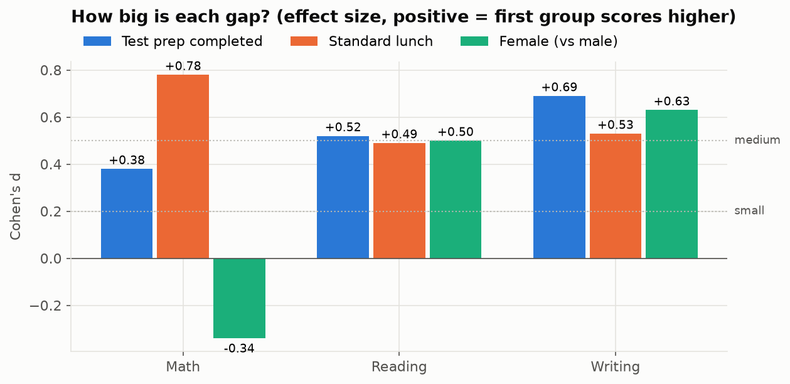
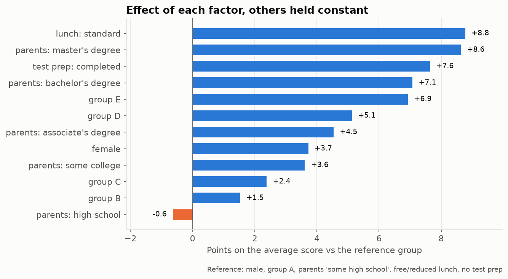
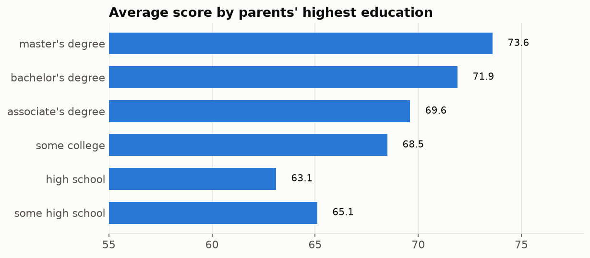
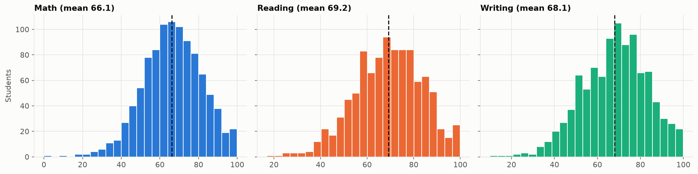

# What drives student exam scores?

1,000 students' math, reading and writing scores vs gender, ethnic group, parents' education, lunch type and test preparation. Every gap is tested with Welch's t-test and sized with Cohen's d; a regression estimates each factor with the others held constant.

**→ [Open the notebook](analysis.ipynb)**

| | |
|---|---|
|  |  |
|  |  |

Observational data: gaps are associations, not causes. Data: [Students Performance in Exams](https://www.kaggle.com/datasets/spscientist/students-performance-in-exams) (Kaggle, fictional).
