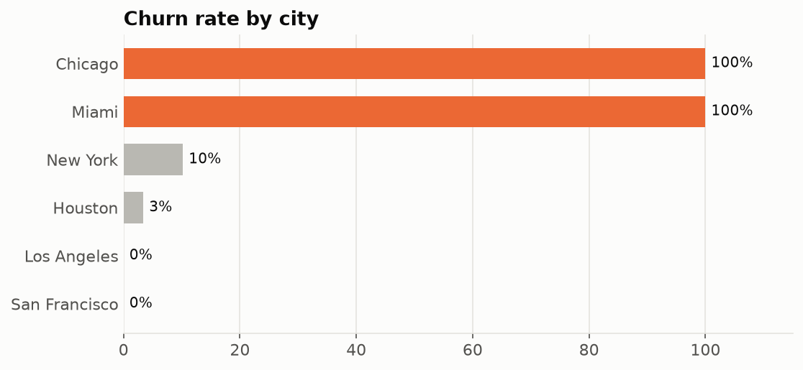
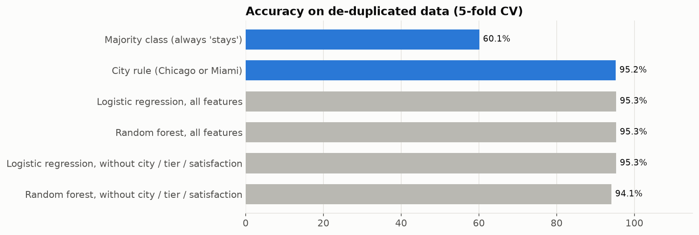
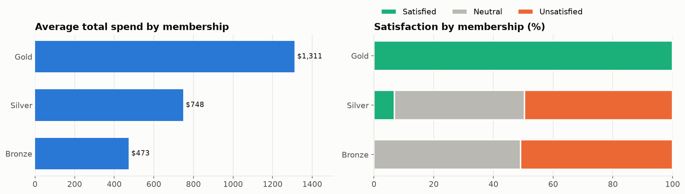

# E-commerce churn: a model that's too good to be true

Reproduces a reported 98% churn-prediction accuracy, then audits the data: half the rows are duplicates, city alone decides churn, and a one-line rule matches the models. Re-evaluated with de-duplication, cross-validation and baselines.

**→ [Open the notebook](analysis.ipynb)**

| | |
|---|---|
|  |  |

Data: [E-commerce Customer Behavior](https://www.kaggle.com/datasets/uom190346a/e-commerce-customer-behavior-dataset) (Kaggle, CC0, synthetic).
