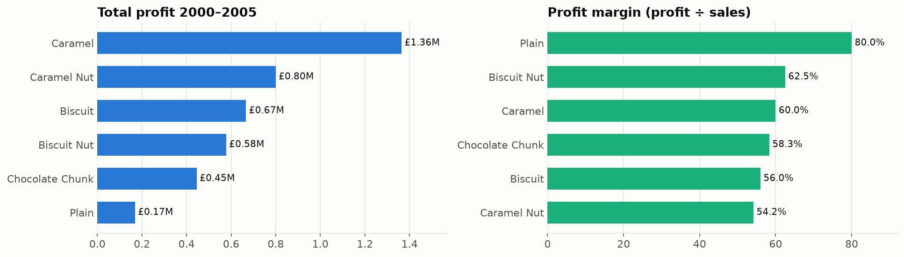
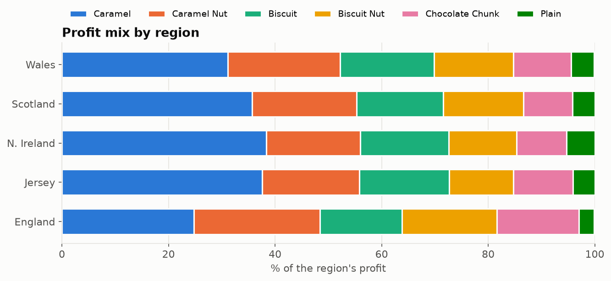
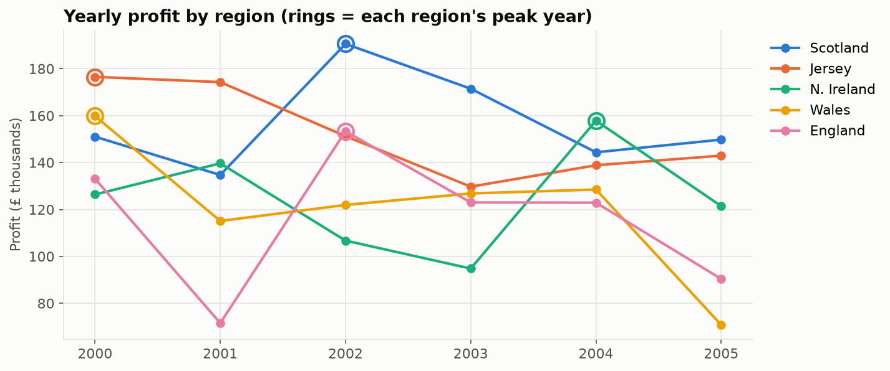
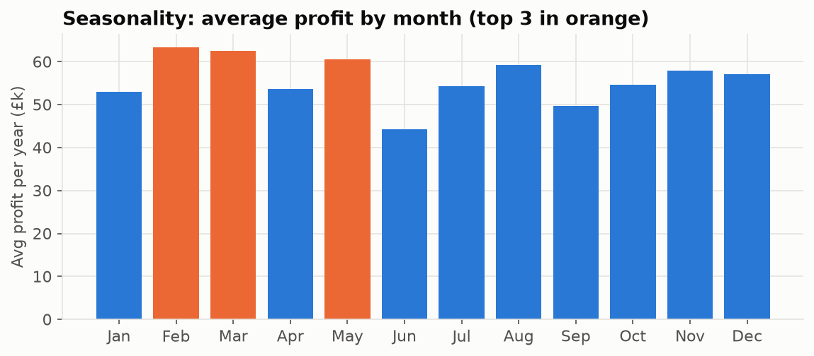

# UK confectionery sales: cleaning, then profit analysis

1,001 sales records (2000–2005, five UK regions, six products). Four data-quality problems found and fixed (misspellings, 74 mislabelled rows, 17 missing values, a broken revenue formula), then profit, margin, regional and seasonal analysis with recommendations.

**→ [Open the notebook](analysis.ipynb)**

| | |
|---|---|
|  |  |
|  |  |

Data: training dataset from a data-visualisation course (`data/confectionery_sales.xlsx`).
