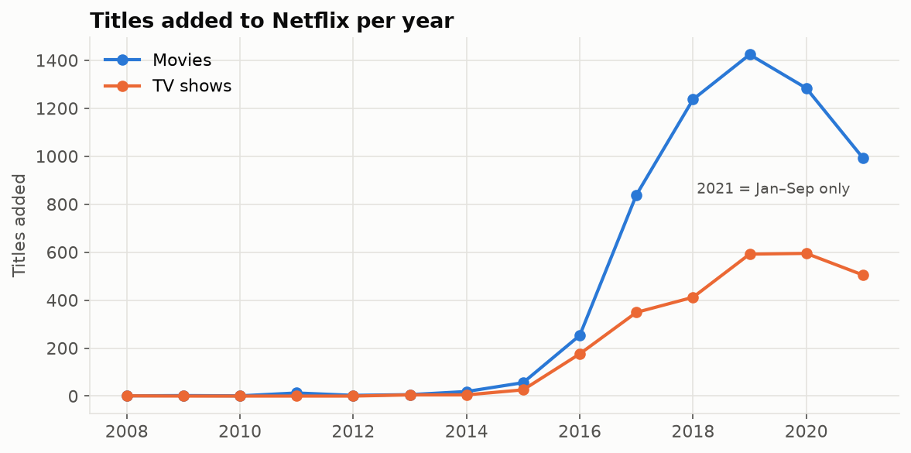

# Data Analysis Portfolio


Four end-to-end analyses with Python (pandas, matplotlib, SciPy, scikit-learn). Each one starts from a question, checks the data before trusting it, and ends with findings computed from the data, not typed in by hand. Every notebook is re-executed by CI on each push, so the outputs you see are the outputs the code produces.

| # | Analysis | Skills shown | Headline |
|---|---|---|---|
| 1 | [**Netflix catalogue**](01-netflix-content) | Cleaning, text parsing, exploding multi-value columns, trends | Movie additions lean more and more on older titles, while TV additions stay new |
| 2 | [**Student exam scores**](02-student-performance) | Hypothesis tests, effect sizes, ANOVA, regression | Family income (lunch type) is the biggest gap: 11 points in math |
| 3 | [**E-commerce churn audit**](03-ecommerce-churn-audit) | Data auditing, leakage, baselines, cross-validation | A "98% accurate" churn model just learned which city a customer lives in |
| 4 | [**UK confectionery sales**](04-confectionery-sales) | Messy-data cleaning, business KPIs, seasonality | 74 rows had the wrong product; margin is the wrong target |

---

## 1. Netflix catalogue: 8,807 titles



- Movies are **70%** of the catalogue, but TV's share of new additions grew from **25% (2018) to 34% (2021)**.
- **Two strategies:** 72% of TV shows added in 2021 were recent releases vs only **40% of movies**, down from 76% in 2016.
- The US is involved in **42%** of titles; India is the clear #2 and is **92% movies**.
- **46%** of titles are rated for adults; kids' titles are only 10%.
- Data fix: 3 titles had their duration typed into the rating column.

→ [Notebook](01-netflix-content/analysis.ipynb)

## 2. What drives student exam scores? 1,000 students


Every gap is tested (Welch's t-test) **and sized** (Cohen's d), because with 1,000 students even trivial gaps are "significant".

- **Lunch type (family income) is the biggest single factor:** 8.6 points on average and 11.1 in math (d = 0.78).
- **Test prep:** +7.6 points on average (d = 0.55), largest for writing (+9.9).
- **Gender gaps run in opposite directions:** girls lead reading and writing (d = 0.50 / 0.63), boys lead math (d = 0.34).
- **All five background factors together explain only 24% of the variation.** Most of what separates students isn't in the data.

→ [Notebook](02-student-performance/analysis.ipynb)

## 3. E-commerce churn: auditing a 98% model


A popular analysis of this dataset reports **98% churn-prediction accuracy**. I reproduced it exactly (98.1%) and then audited the data:

- **182 of 350 rows are duplicates.** 88% of the test rows already appeared in training.
- **Every customer in Chicago and Miami churns; almost no one elsewhere does.** Each city also has exactly one membership tier and its own narrow spending band, so the data is synthetic.
- **A one-line rule ("lives in Chicago or Miami") scores 95.2%; the models score 95.3%.** They learned the rule, not customer behaviour.

**Lesson:** check for duplicates, leakage and suspiciously clean patterns, and compare against a simple baseline before trusting a high score.

→ [Notebook](03-ecommerce-churn-audit/analysis.ipynb)

## 4. UK confectionery sales: 1,001 records, 2000–2005


Most of the work was cleaning. Each fix was proven from the data first:

| Problem | Evidence | Fix |
|---|---|---|
| Misspelt products | "Choclate Chunk", "Caramel nut" | Standardised names |
| **74 mislabelled rows** | "Caramel" rows in England with other products' exact unit costs | Recovered the true product from the unit cost |
| 17 missing values | Units / cost / profit blanks | Rebuilt from fixed unit prices |
| **Broken revenue column** | Equals units × (profit − cost) for 98% of rows, hence negative values | Recomputed sales = cost + profit |

**Findings:**
- **Caramel earns the most profit (£1.36M).** Plain has the best margin (80%) but earns only £0.80 per unit, while Caramel Nut has the lowest margin but the highest profit per unit (£3.25), so **margin alone is the wrong target**.
- **England looks weakest, but only because it has 23% fewer records.** Its profit per sale ranks #3 of 5.

→ [Notebook](04-confectionery-sales/analysis.ipynb)

---

## Repository layout

```
├── common/style.py              # Shared chart style (colour-blind-safe palette)
├── 01-netflix-content/
│   ├── analysis.ipynb           # Executed notebook (start here)
│   ├── analysis.py              # Same analysis as a plain script (easy to diff)
│   ├── data/
│   └── figures/
├── 02-student-performance/  ...
├── 03-ecommerce-churn-audit/ ...
└── 04-confectionery-sales/  ...
```

## Run it

```bash
git clone https://github.com/arslanahmedbhutto/data-analysis-portfolio.git
cd data-analysis-portfolio
python -m venv .venv
source .venv/bin/activate         # Windows: .venv\Scripts\activate
pip install -r requirements.txt
cd 01-netflix-content && jupyter notebook analysis.ipynb
```

## Data sources

- [Netflix Movies and TV Shows](https://www.kaggle.com/datasets/shivamb/netflix-shows) (Kaggle)
- [Students Performance in Exams](https://www.kaggle.com/datasets/spscientist/students-performance-in-exams) (Kaggle, fictional data)
- [E-commerce Customer Behavior](https://www.kaggle.com/datasets/uom190346a/e-commerce-customer-behavior-dataset) (Kaggle, synthetic)
- Confectionery sales: training dataset used in a data-visualisation course I teach

## Related projects

[customer-segmentation-kmeans](https://github.com/arslanahmedbhutto/customer-segmentation-kmeans) · [stock-forecasting-lstm-gru](https://github.com/arslanahmedbhutto/stock-forecasting-lstm-gru) · [breast-cancer-classification](https://github.com/arslanahmedbhutto/breast-cancer-classification)
